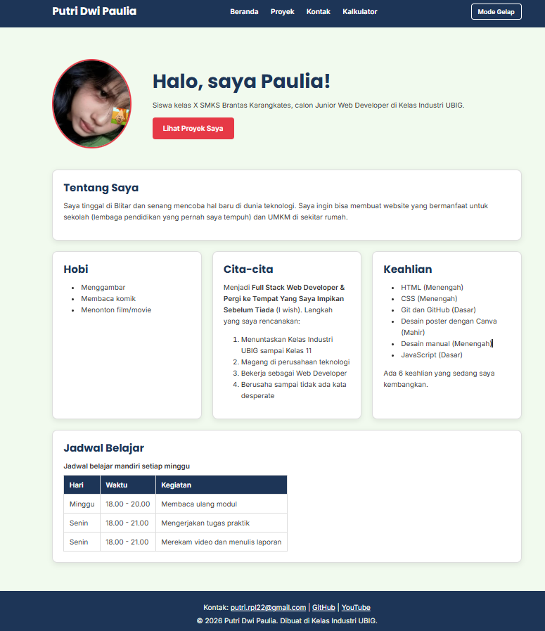

# Portofolio Putri Dwi Paulia
Website portofolio pribadi yang saya buat di Kelas Industri UBIG
(Paket 1, Minggu 01 sampai 09).
Versi ini adalah **Portofolio v2**: tampil rapi di ponsel, tablet,
dan laptop, serta interaktif dengan JavaScript.
## Tampilan

## Fitur
- Halaman **Beranda** berisi profil, hobi, cita-cita, jadwal
belajar, dan daftar keahlian dari `data/keahlian.json` yang bisa
ditambah
- Halaman **Proyek** berisi enam kartu proyek dari
`data/proyek.json` dengan filter kategori, serta repositori GitHub
terbaru dari GitHub API
- Halaman **Kontak** berisi form dengan penghitung karakter pesan
- Mode gelap di semua halaman
- Tampilan responsif dengan Flexbox dan *media query*
- Fitur penghitung karakter dalam kotak pesan yang memiliki maksimum 300 karakter
## Teknologi
- HTML5 dan CSS3 (Flexbox, *media query*, dan variabel CSS)
- JavaScript (DOM, *event*, `fetch`, dan `async`/`await`)
- JSON dan GitHub REST API
- Git, GitHub, dan Vercel
## Skor Lighthouse (mobile)
- Beranda: Performance 99, Accessibility 94, Best Practices 100,
SEO 91
- Proyek: Performance 98, Accessibility 94, Best Practices 96, SEO
91
- Kontak: Performance 98, Accessibility 93, Best Practices 99, SEO
90
## Tautan
- Website: https://portofolio-.vercel.app
- Dibuat oleh: Putri Dwi Paulia, SMKS Brantas Karangkates